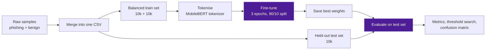

<div align="center">


</div>

---

## 🧠 What This Is

A Google Colab notebook that trains and evaluates a **phishing detector** by fine-tuning **MobileBERT**, a small and fast language model. It follows the pipeline of the open-source **[PhishLang](https://github.com/UTA-SPRLab/phishlang)** project (University of Texas at Arlington, SPR Lab) and adapts it for a university assignment.

Given a text sample from a website, the model predicts one of two classes: **phishing** or **benign**.

| | |
|---|---|
| **Model** | MobileBERT (`google/mobilebert-uncased`) with a classification head |
| **Training data** | 20,000 rows, balanced: 10,000 phishing and 10,000 benign |
| **Validation** | Stratified 90/10 split inside the training data |
| **Test data** | 10,000 held-out rows, with 0 overlap with the training set |
| **Training** | 3 epochs, sequences padded or truncated to 200 tokens, GPU |
| **Outputs** | Saved model weights, per-epoch confusion matrices, test metrics |

> 📝 The input column in the CSVs is named `url`, but the original data column was `text_content`. Check what your CSV actually holds, then describe the input accurately in your report (URL string or page text).

---

## 🔍 Who Uses Phishing Detection and Why

| Who | How they use it | Why it matters |
|---|---|---|
| 🛡️ **SOC and security teams** | Triage suspicious links and pages reported by staff | A fast first-pass classifier saves analyst time |
| ✉️ **Email and web gateways** | Score content before it reaches users | Blocking a phishing page early stops credential theft |
| 🌐 **Browser extension developers** | Run a small model on-device | MobileBERT is light enough to be practical, and data can stay local |
| 🔬 **Researchers** | Benchmark new models on the same splits | Fixed train and test sets make results comparable |
| 🎓 **Students** | Learn fine-tuning, thresholds and evaluation | A complete worked example from raw data to metrics |

---

## ⚙️ Pipeline



**Steps in the notebook**

1. Mount Google Drive and clone PhishLang
2. Check library versions and CUDA
3. Rebuild the training data zip from its parts and load the labelled CSVs
4. Create `D_Train.csv` (balanced 20k) and `D_Test.csv` (10k), and confirm there is no overlap
5. Train with a one-cell trainer that uses the original `Model_MMA` if it is available, otherwise a MobileBERT fallback
6. Validate each epoch and save confusion matrices
7. Evaluate on the test set at the default threshold and at a searched threshold

---

## 📊 Results

Test set of 10,000 samples, average loss **0.4314**.

| Threshold | Accuracy | Precision | Recall | F1 |
|---|---|---|---|---|
| **0.50** (default) | 80.80% | 59.07% | 80.73% | 68.22% |
| **0.75** (best accuracy) | **84.49%** | **73.81%** | 60.83% | 66.70% |

**Reading the numbers**

- At the default threshold the model catches about 81% of phishing samples but flags many legitimate ones (precision is about 59%).
- Raising the threshold to 0.75 cuts false alarms, but it misses more phishing (recall drops to about 61%).
- Which trade-off is better depends on the use case: a mail gateway usually prefers fewer false alarms, while a high-risk review queue prefers higher recall.

---

## 🚀 How to Run

The notebook is written for **Google Colab** with a GPU runtime and files in Google Drive.

1. Open the notebook in Colab and choose **Runtime, then Change runtime type, then GPU**.
2. Put the project in Drive under `MyDrive/assignment/`, with the training data in `training_data/` and CSVs in `training_data/csv/`.
3. Run the cells in order:
   - mount Drive, clone PhishLang and install requirements
   - build the dataset and create `D_Train.csv` and `D_Test.csv`
   - run the trainer cell
   - run the test evaluation cell
4. Find the saved weights and confusion-matrix images in the output paths printed by the trainer.

```text
MyDrive/assignment/
├── src/                      # PhishLang source files
└── training_data/
    ├── parsed_samples_part_* # split zip parts
    └── csv/
        ├── merged_phish_benign.csv
        ├── D_Train.csv
        └── D_Test.csv
```

---

## ⚠️ Limitations and Notes

- **Fallback model:** the evaluation run printed `Model_MMA not found`, so it used the plain MobileBERT fallback instead of PhishLang's own model.
- **Sequence length:** training pads to 200 tokens, while the final evaluation cell pads to 256. Using the same value in both is cleaner.
- **Threshold choice:** the 0.75 threshold was chosen on the test set. Choosing it on the validation split gives a fairer estimate.
- **Class balance:** precision is much lower than recall at the default threshold, so check the class mix of the test set before drawing conclusions.
- **Prototype only:** this is a coursework experiment, not a production security control.

---

## 🧰 Tech Stack


---

## 🙏 Credits

- **[PhishLang](https://github.com/UTA-SPRLab/phishlang)** by UTA SPR Lab, whose code and pipeline this notebook builds on
- **MobileBERT** (`google/mobilebert-uncased`) via Hugging Face Transformers

---

<div align="center">

### 📫 Let's Connect

**Shady** · Cyber Security student, Asia Pacific University

[](https://www.linkedin.com/in/shady-ehab-07666a255)
[](mailto:shadysoliman3322@gmail.com)


</div>
